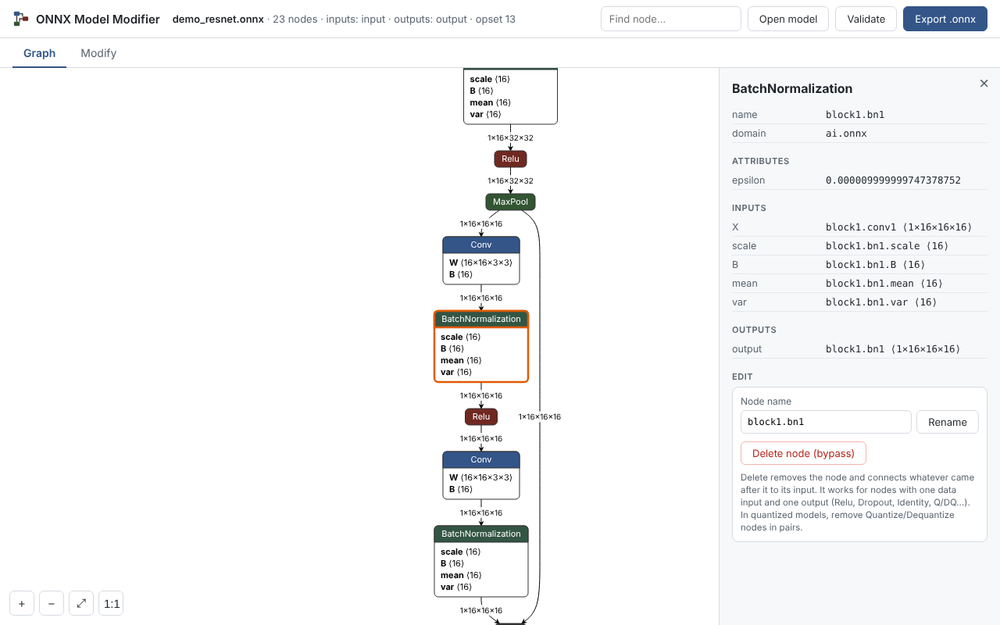
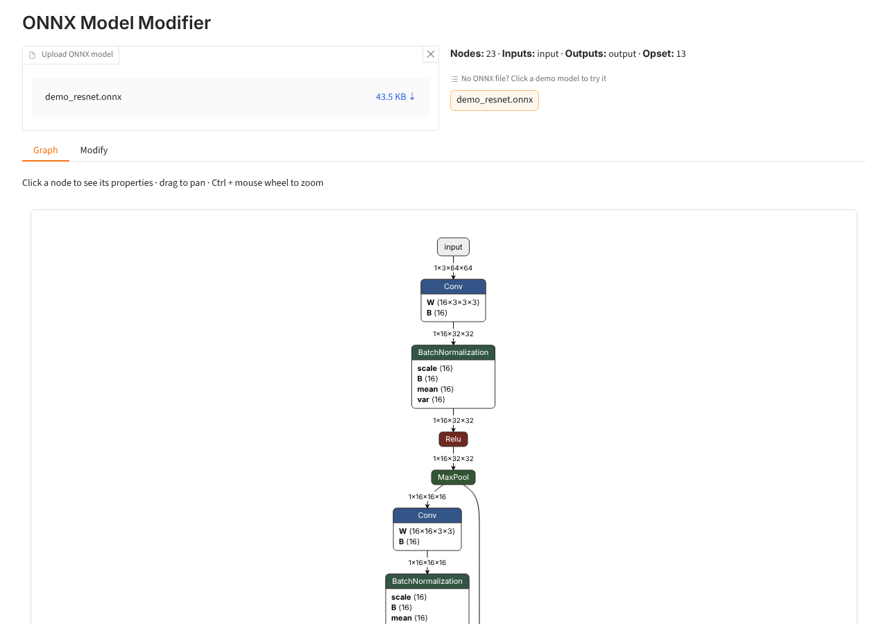
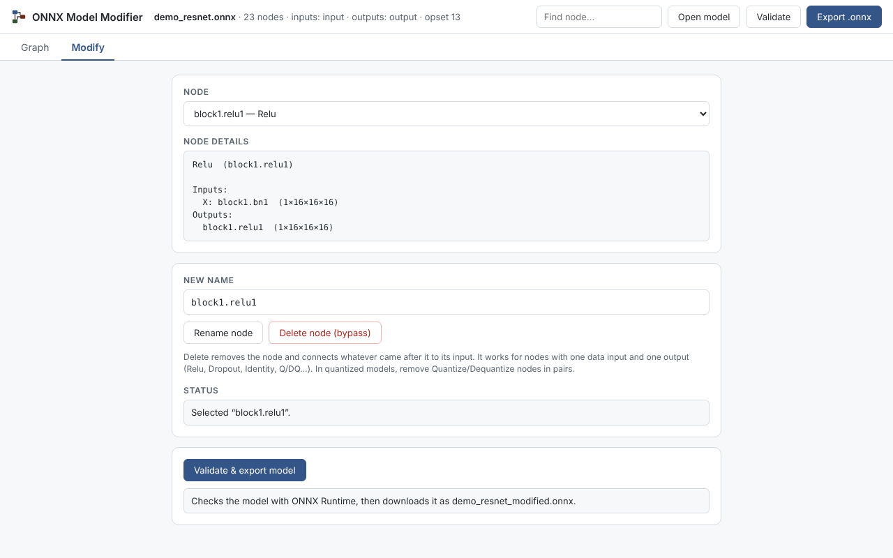

# ONNX Model Modifier

A Python tool for **viewing and editing ONNX models**: a Netron-style graph viewer that can also rename nodes, remove nodes with automatic rewiring, validate the result with ONNX Runtime, and export the modified model.

**▶ Live demo:** https://pavani541-onnx-modifier.static.hf.space (click *Small ResNet* to try it, no install needed)



## Why

Netron is great for looking at a model, but it can't change one. This tool keeps the familiar Netron-style view and adds the common edits: inspect a node, rename it, remove a layer, then confirm the model still loads.

## Features

- **Netron-style graph**: each node is a card showing its weights, scales and zero-points, laid out top to bottom with tensor shapes on the edges and colour-coded operator types
- **Node details**: attributes, inputs and outputs with shapes (from ONNX shape inference)
- **Rename nodes**, with duplicate-name checks
- **Delete (bypass) nodes**: removes a single-input / single-output node (Relu, Dropout, Identity, Quantize/Dequantize…) and reconnects its consumers to its input, so the graph stays connected
- **Validate & export**: strict ONNX checker plus a real load in ONNX Runtime, then download the modified `.onnx`
- Handles models with empty or duplicate node names, and quantized (QDQ) models

## Tech stack

| Part | Built with |
|---|---|
| Core app | **Python**: `onnx` (graph parsing, editing, shape inference, checker), `onnxruntime` (validation), NumPy, **Gradio** (UI) |
| Graph layout | dagre (same layout engine Netron uses), rendered as SVG |
| Tooling | **Python** scripts that build the demo model and generate the operator metadata for the web version |
| Web version | JavaScript port of the Python app (protobuf.js + ONNX Runtime Web), so it can be hosted for free as a static site |

## Run the Python app

```bash
git clone https://github.com/pavani2493-dot/ONNX-model-modifier.git
cd ONNX-model-modifier
python -m venv venv
venv\Scripts\activate            # Windows  (Linux/macOS: source venv/bin/activate)
pip install -r requirements.txt
python ONNX_modifier.py
```

Open http://127.0.0.1:7860, then upload a `.onnx` file or click the demo model.



## How editing works

**Delete (bypass)**: for a node `A → X → B`, the tool points every consumer of `X`'s output at `X`'s input, so the graph becomes `A → B`. If `X` was producing a graph output, the output is renamed to `X`'s input. Its stale shape information is removed. Nodes with several data inputs (`Add`, `Concat`…) are refused, because there's no single input to reconnect.

**Validate & export**: the model is saved, checked with `onnx.checker.check_model(full_check=True)` (strict type and shape inference), and loaded in an ONNX Runtime session. For example, deleting only the `QuantizeLinear` of a Q/DQ pair is caught: the following `DequantizeLinear` would receive `float` instead of `uint8`.



## Project structure

```
ONNX_modifier.py            Python app (Gradio): loading, graph building, editing, validation, export
requirements.txt
dagre.min.js                graph layout library used by the app's viewer
examples/demo_resnet.onnx   small public demo model (random weights)
tools/
  make_demo_model.py        builds the demo ResNet with the ONNX graph API
  generate_onnx_defs.py     exports operator input names + onnx.proto for the web version
docs/                       web version, served by GitHub Pages
screenshots/
```

## Web version

`docs/` holds a browser-only port of the app (same Graph / Modify tabs). Everything runs locally in the visitor's browser, so models are never uploaded. To publish it with GitHub Pages: **Settings → Pages → Deploy from a branch → `main` / `/docs`**.

## Credits

Graph style inspired by [Netron](https://github.com/lutzroeder/netron). Uses [ONNX](https://github.com/onnx/onnx), [ONNX Runtime](https://github.com/microsoft/onnxruntime), [Gradio](https://github.com/gradio-app/gradio), [dagre](https://github.com/dagrejs/dagre) and [protobuf.js](https://github.com/protobufjs/protobuf.js).
